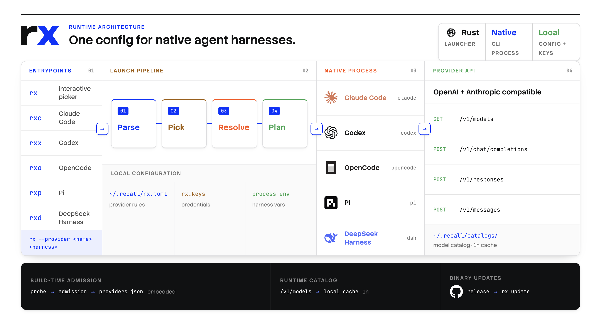

# Rx

`rx` launches rx-agent, Claude Code, Codex, OpenCode, Pi, DeepSeek Harness, and Kimi Code with one provider configuration. rx-agent is Rx's own coding agent, built from [`agent/`](agent/); the other harnesses run their native CLI.

[](assets/rx-architecture.png)

## Install

Requires Rust, [Bun](https://bun.sh), and pnpm.

```bash
git clone https://github.com/samzong/Rx.git
cd Rx
make install
```

## Usage

```bash
rx providers login
rxa
rx codex
rx --provider openrouter opencode
rx --provider none claude
rx dsh web
rx kimi
```

Running `rx` without a harness opens the picker; `tab` there picks a configured provider for that launch only, leaving the default unchanged. Arguments after the harness name are passed to that harness.
For Kimi Code, `rx` seeds the selected provider and its cached models as `rx-<provider>/<model>` aliases in Kimi's native catalog. `--model <id>` selects one of those models. Without it or a provider-level `model` in `rx.toml`, `rx` uses the first cached provider model and reports that choice on stderr. Rx-owned entries are refreshed only while their payload remains unchanged; native and user-edited entries are preserved. Kimi requires catalog credentials in its config, so the selected provider key is also stored in Kimi's local `config.toml` with secret-only file permissions.

Concurrent `rx kimi` launches retain their catalog aliases until they exit. A later
launch reclaims unchanged entries no longer used by a running launch. Changing
an active alias to a different route fails; close the launch using that alias
before retrying. Identical catalog snapshots reuse a shared lease file; empty
lease files are retained as catalogs change, without automatic cleanup.

When upgrading from a version 1 Kimi catalog marker, first close all Kimi
sessions started by older Rx versions. Run the same `rx kimi` command in a
terminal and type `migrate` when prompted to confirm those sessions have exited.
Declining the prompt or running without a terminal leaves the existing catalog
unchanged. Older Rx versions cannot update the migrated catalog. Keep the
catalog marker and lease files in place, including when rolling back Rx.

| Harness | Commands |
| --- | --- |
| rx-agent | `rx rx-agent`, `rxa` (`rx agent` is an alias) |
| Claude Code | `rx claude`, `rxc` |
| Codex | `rx codex`, `rxx` |
| OpenCode | `rx opencode`, `rxo` |
| Pi | `rx pi`, `rxp` |
| DeepSeek Harness | `rx dsh`, `rxd` |
| Kimi Code | `rx kimi`, `rxk` |

### rx-agent

`rx rx-agent` and `rxa` start rx-agent with the selected provider, its cached
models, and its key in the child environment. The model is the first of
`--model <provider>/<id>`, the provider-level `model` in `rx.toml`, `model` in
`$RX_HOME/config.json` (default `~/.rx/config.json`), the provider's default
model, and the first listed model. `config.json` applies only to a model of
the launched provider; when it names another provider's model or a model this
launch cannot use, rx-agent says so on stderr and uses the launch default. With
`--provider none`, rx-agent runs as-is and resolves models through pi-ai and
its own `$RX_HOME/config.json`.

```json
{ "model": "tokener/claude-opus-5", "thinking": "medium" }
```

```bash
rxa                          # interactive session
rxa -p "..."                 # one prompt, then exit
rxa -c                       # continue the latest session here
rxa sessions                 # list sessions
rxa acp                      # serve the Agent Client Protocol on stdio
rx-agent login [provider]    # sign in to a subscription or store an API key
rx-agent logout <provider>   # remove stored credentials
```

rx-agent works in the current directory with `read`, `write`, `edit`, and
`bash`, running with your permissions and no sandbox. Sessions are append-only
logs under `$RX_HOME/sessions/` (`RX_HOME` defaults to `~/.rx`). To use it from
an editor that speaks ACP, configure the editor to run `rx rx-agent acp`. See
[agent/DESIGN.md](agent/DESIGN.md) for its contract.

rx-agent keeps its own credentials, separate from `rx providers`.
`rx-agent login` without a provider lists the providers that support login.
ChatGPT subscriptions (`openai` or `openai-codex`) sign in through the browser
or a device code; API-key providers such as `deepseek` prompt for the key.
Credentials are stored in `$RX_HOME/auth.json` with owner-only permissions.
To use a stored subscription during an rx launch, pass its model, for example
`rxa --model openai-codex/<id>`.

Provider commands:

```bash
rx providers list
rx providers use <provider>
rx providers models update [provider]
rx providers logout <provider>
```

Bundled provider metadata is compiled into the binary. Live model catalogs come from the selected provider and are cached under `~/.recall/catalogs/` for one hour. Custom provider configuration and admission requirements are documented in [PROVIDERS.md](docs/PROVIDERS.md).

## Development

Install Rust and cargo-audit 0.22.2, then run:

```bash
cargo install cargo-audit --locked --version 0.22.2
make check
make build
```

`make install` installs `rx`, its seven shortcuts, and the single-file `rx-agent`
binary compiled by `bun build --compile` into the Cargo bin directory.
`make agent-check` audits, type-checks, and tests `agent/`.
Shell completions are available through `rx completions bash|zsh|fish`.
The GitHub release workflow builds the four supported targets from the checked tag.

See [DESIGN.md](docs/DESIGN.md) for native behavior and ownership rules,
[PROVIDERS.md](docs/PROVIDERS.md) for provider admission, and
[HOSTING.md](docs/HOSTING.md) for the embedding protocol.
