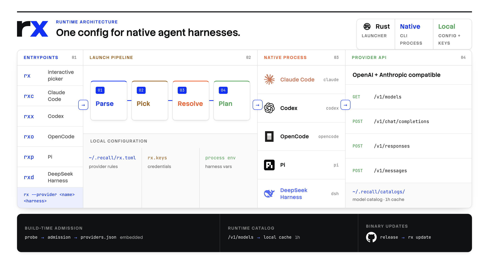

<h1>
  <picture>
    <source media="(prefers-color-scheme: dark)" srcset="assets/brand/logo-dark.svg">
    <source media="(prefers-color-scheme: light)" srcset="assets/brand/logo-light.svg">
    
  </picture>
</h1>

`rx` launches rx-agent, Claude Code, Codex, OpenCode, Pi, DeepSeek Harness, and Kimi Code with one provider configuration. rx-agent is Rx's own coding agent, built from [`agent/`](agent/); the other harnesses run their native CLI.

[](assets/rx-architecture.png)

## Install

Prebuilt binaries need no Rust, Bun, or pnpm. Download the matching archives
from [Rx v0.2.1](https://github.com/samzong/Rx/releases/tag/v0.2.1) and
[rx-agent v0.2.0](https://github.com/samzong/Rx/releases/tag/rx-agent-v0.2.0).
Rx archives contain only `rx`. Install both binaries for the steps below.

| Platform | Rx archive | rx-agent archive |
| --- | --- | --- |
| macOS Apple Silicon | `rx-macos-aarch64.tar.gz` | `rx-agent-darwin-arm64.tar.gz` |
| macOS Intel | `rx-macos-x86_64.tar.gz` | `rx-agent-darwin-x64.tar.gz` |
| Linux x86_64 | `rx-linux-x86_64.tar.gz` | `rx-agent-linux-x64.tar.gz` |
| Windows x86_64 | `rx-windows-x86_64.zip` | `rx-agent-windows-x64.zip` |

Download `SHA256SUMS` from each release into separate directories with its archive.
Make sure that each archive matches its SHA-256 entry before extraction.
On macOS Apple Silicon, run these commands in the two download directories:

```bash
grep ' rx-macos-aarch64.tar.gz$' SHA256SUMS | shasum -a 256 -c -
```

```bash
grep ' rx-agent-darwin-arm64.tar.gz$' SHA256SUMS | shasum -a 256 -c -
```

Extract both archives. On macOS or Linux, install the extracted binaries:

```bash
mkdir -p "$HOME/.local/bin"
install -m 755 /path/to/extracted/rx "$HOME/.local/bin/rx"
install -m 755 /path/to/extracted/rx-agent "$HOME/.local/bin/rx-agent"
for name in rxa rxc rxx rxo rxp rxd rxk; do
  ln -sf rx "$HOME/.local/bin/$name"
done
export PATH="$HOME/.local/bin:$PATH"
rx --version
rx-agent --version
```

Replace `/path/to/extracted/` with each extraction directory.
On Windows, extract both executables into a directory on PATH and use
`rx rx-agent` in place of the `rxa` shortcut.
An rx-agent binary on PATH bypasses managed agent updates.
Replace that binary with a newer release to update it.

To build from source instead, install Rust, [Bun](https://bun.sh), and pnpm:

```bash
git clone https://github.com/samzong/Rx.git
cd Rx
make install
```

## First run

On a fresh installation without provider setup, `rxa` exits 1 with
`no model selected`. Configure a provider before starting a session.
For OpenRouter, set `OPENROUTER_API_KEY` in your shell environment, then run:

```bash
rxa
```

With no provider selection, Rx selects OpenRouter when this variable is set.
Rx supplies the provider's model catalog and a default model to rx-agent.
To select a model explicitly, use `rxa --model openrouter/<model-id>`.

To store an API key and select another provider, run `rx providers login`
in a terminal, choose the provider, and enter its key. Then run `rxa`.
The launcher's credentials and `rx-agent login` credentials use separate stores.

Before connecting Lody, make sure that `rxa` opens a terminal session.
In Lody, configure the custom agent to run `rx rx-agent acp` with the same
PATH and provider environment. ACP launches cannot prompt to install rx-agent.
With the prebuilt installation above, both binaries are already on PATH.

## Usage

```bash
rx providers login
rxa
rx codex
rx --provider openrouter opencode
rx --provider none claude
rx dsh web
rx kimi
```

Running `rx` without a harness opens the picker; `tab` there picks a configured provider for that launch only, leaving the default unchanged. Arguments after the harness name are passed to that harness.
For Kimi Code, `rx` seeds the selected provider and its cached models as `rx-<provider>/<model>` aliases in Kimi's native catalog. `--model <id>` selects one of those models. Without it or a provider-level `model` in `rx.toml`, `rx` uses the first cached provider model and reports that choice on stderr. Rx-owned entries are refreshed only while their payload remains unchanged; native and user-edited entries are preserved. Kimi requires catalog credentials in its config, so the selected provider key is also stored in Kimi's local `config.toml` with secret-only file permissions.

Concurrent `rx kimi` launches retain their catalog aliases until they exit. A later
launch reclaims unchanged entries no longer used by a running launch. Changing
an active alias to a different route fails; close the launch using that alias
before retrying. Identical catalog snapshots reuse a shared lease file; empty
lease files are retained as catalogs change, without automatic cleanup.

When upgrading from a version 1 Kimi catalog marker, first close all Kimi
sessions started by older Rx versions. Run the same `rx kimi` command in a
terminal and type `migrate` when prompted to confirm those sessions have exited.
Declining the prompt or running without a terminal leaves the existing catalog
unchanged. Older Rx versions cannot update the migrated catalog. Keep the
catalog marker and lease files in place, including when rolling back Rx.

| Harness | Commands |
| --- | --- |
| rx-agent | `rx rx-agent`, `rxa` (`rx agent` is an alias) |
| Claude Code | `rx claude`, `rxc` |
| Codex | `rx codex`, `rxx` |
| OpenCode | `rx opencode`, `rxo` |
| Pi | `rx pi`, `rxp` |
| DeepSeek Harness | `rx dsh`, `rxd` |
| Kimi Code | `rx kimi`, `rxk` |

### rx-agent

If rx-agent is not on PATH or beside Rx, `rxa` in a terminal offers to install it
from this repository's `rx-agent-v*` releases after a SHA-256 check (`[y/N]`, Enter declines).
Rx checks for a new managed version in the background at most once per 24 hours.
The new version takes effect at the next launch. Rx keeps the current and previous versions.
`RX_NO_INSTALL=1` disables the prompt and `RX_NO_UPDATE=1` disables update checks.
See [distribution](agent/docs/distribution.md).

`rx rx-agent` and `rxa` start rx-agent with the selected provider, its cached
models, and its key in the child environment. The model is the first of
`--model <provider>/<id>`, the provider-level `model` in `rx.toml`, `model` in
`$RX_HOME/config.json` (default `~/.rx/config.json`), the provider's default
model, and the first listed model. `config.json` applies only to a model of
the launched provider; when it names another provider's model or a model this
launch cannot use, rx-agent says so on stderr and uses the launch default. With
`--provider none`, rx-agent runs as-is and resolves models through pi-ai and
its own `$RX_HOME/config.json`.

```json
{ "model": "tokener/claude-opus-5", "thinking": "medium" }
```

```bash
rxa                          # interactive session
rxa "Read notes.txt"
rxa -- "-review this change"
rxa -p "..."                 # one prompt, then exit
rxa -c                       # continue the latest session here
rxa sessions                 # list sessions
rxa acp                      # serve the Agent Client Protocol on stdio
rx-agent login [provider]    # sign in to a subscription or store an API key
rx-agent logout <provider>   # remove stored credentials
```

rx-agent works in the current directory with `read`, `write`, `edit`, and
`bash`, running with your permissions and no sandbox. Sessions are append-only
logs under `$RX_HOME/sessions/` (`RX_HOME` defaults to `~/.rx`). To use it from
an editor that speaks ACP, configure the editor to run `rx rx-agent acp`. See
[agent/DESIGN.md](agent/DESIGN.md) for its contract.

Add MCP servers in `$RX_HOME/mcp.json` or supply them through ACP new/load.
rx-agent supports stdio and Streamable HTTP. See [MCP tools](agent/docs/mcp.md).

Long sessions compact automatically before a model request reaches its context budget.
In the REPL or ACP, enter `/compact` to compact the session now.
Stop cancels a summary request. The complete session history remains in the log.
Resume uses the latest completed checkpoint. Older Rx versions replay the full history and can overflow again.
Generic summaries do not replay old native reasoning or signed thinking.

rx-agent keeps its own credentials, separate from `rx providers`.
`rx-agent login` without a provider lists the providers that support login.
ChatGPT subscriptions (`openai` or `openai-codex`) sign in through the browser
or a device code; API-key providers such as `deepseek` prompt for the key.
Credentials are stored in `$RX_HOME/auth.json` with owner-only permissions.
To use a stored subscription during an rx launch, pass its model, for example
`rxa --model openai-codex/<id>`.

Provider commands:

```bash
rx providers list
rx providers use <provider>
rx providers models update [provider]
rx providers logout <provider>
```

Bundled provider metadata is compiled into the binary. Live model catalogs come from the selected provider and are cached under `~/.recall/catalogs/` for one hour. Custom provider configuration and admission requirements are documented in [PROVIDERS.md](docs/PROVIDERS.md).

## Development

Install Rust and cargo-audit 0.22.2, then run:

```bash
cargo install cargo-audit --locked --version 0.22.2
make check
make build
```

`make install` installs `rx`, its seven shortcuts, and the single-file `rx-agent`
binary compiled by `bun build --compile` into the Cargo bin directory.
`rx --version`, `rxa --version`, and `rx-agent --version` then add the source
commit and its date, for example `rx 0.2.0 (1afb9fcbd 2026-10-26)`; an
uncommitted tree adds `dirty` and the build time. Release binaries and plain
`cargo build` print only the version.
`make agent-check` audits, type-checks, and tests `agent/`.
Shell completions are available through `rx completions bash|zsh|fish`.
The GitHub release workflow builds the four supported targets from the checked tag.

See [DESIGN.md](docs/DESIGN.md) for native behavior and ownership rules,
[PROVIDERS.md](docs/PROVIDERS.md) for provider admission, and
[HOSTING.md](docs/HOSTING.md) for the embedding protocol.
